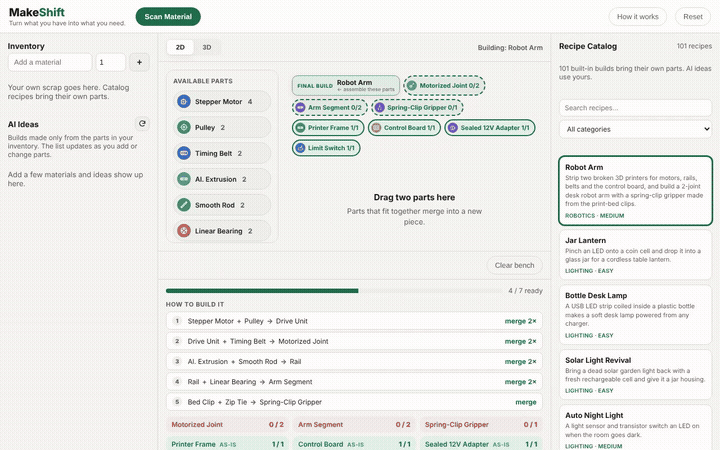
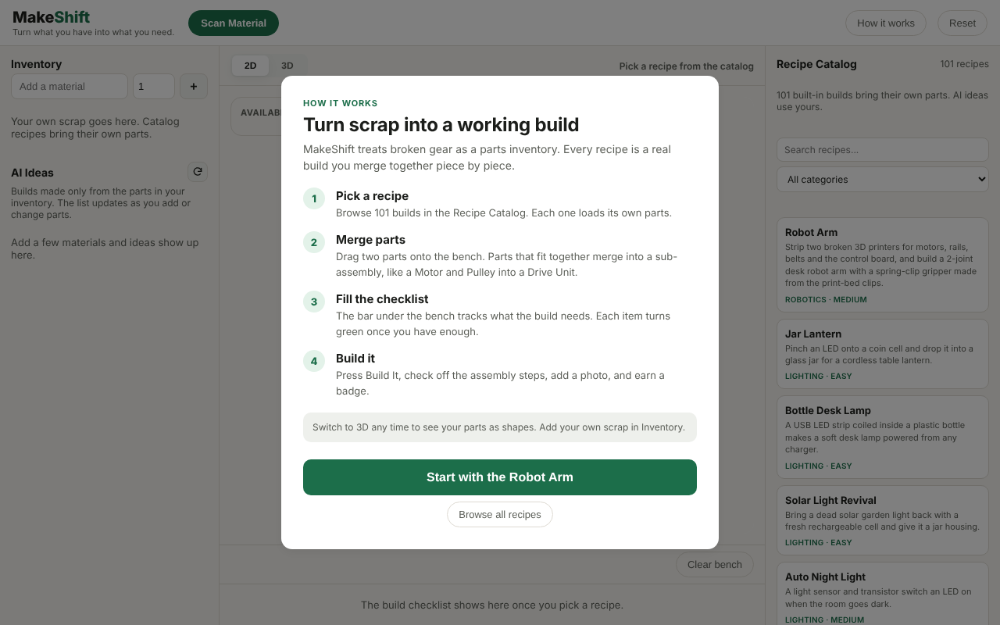
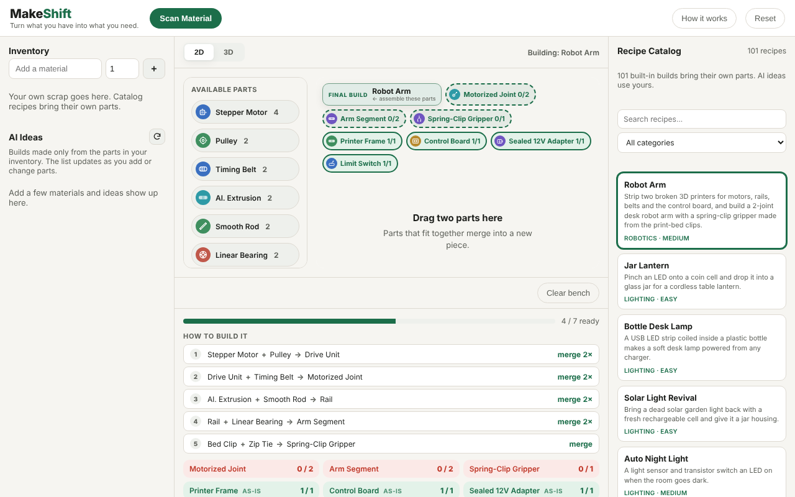
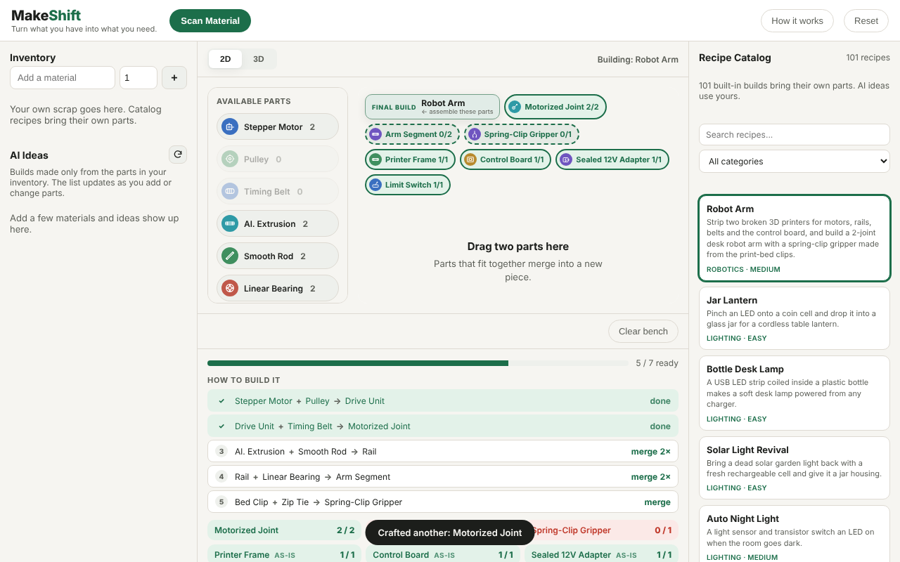
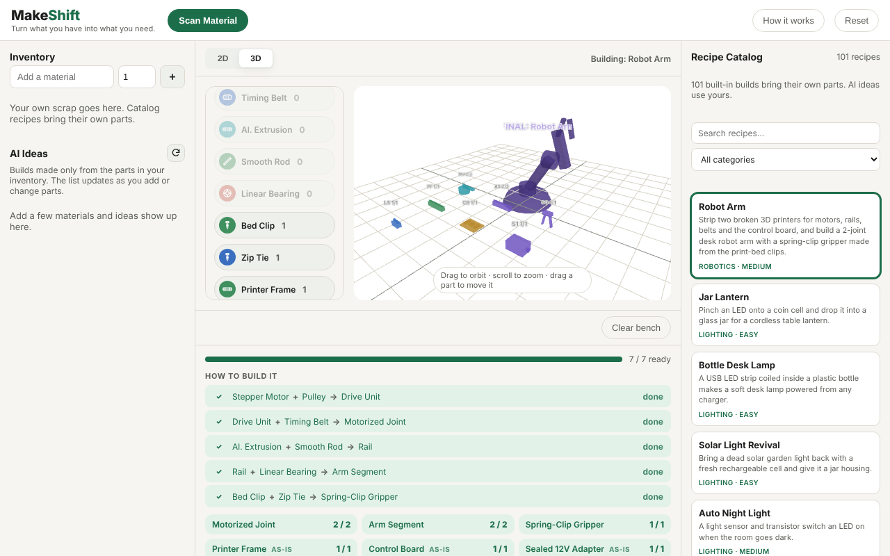
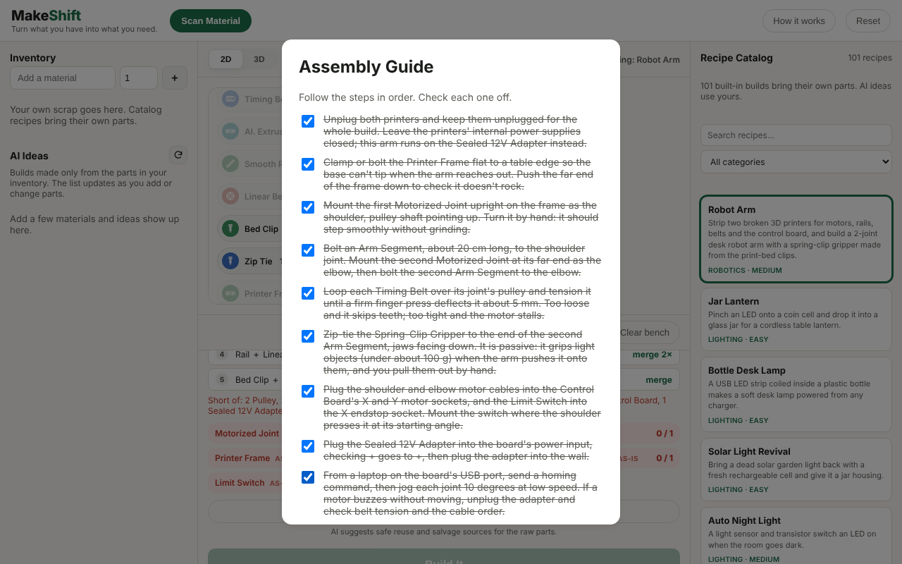
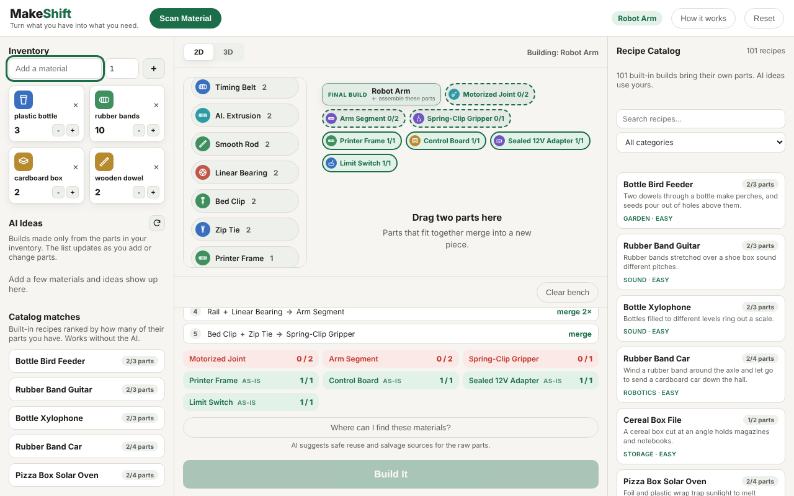

# MakeShift

Turn what you have into what you need.

MakeShift treats broken gear and scrap as a parts inventory. Tell it what you have, pick a build, drag parts together to merge them into sub-assemblies, then follow a step-by-step assembly guide to make something real.

**Try it:** [adipurohit.com/makeshift](https://adipurohit.com/makeshift) · **Demo video:** [docs/demo.mp4](docs/demo.mp4) (about 60 s, works offline as a fallback)



## What it does

- **Works without AI.** 101 built-in recipes across 10 categories. Type in your scrap and **Catalog matches** ranks the recipes by how many of their parts you already have. No API key, no Wi-Fi.
- **Guides every build.** The "How to build it" list shows each merge in order and checks it off as you go. Parts marked **as-is** go straight into the build.
- **AI ideas from your own parts** (needs a Gemini key): up to 14 builds using only what's in your inventory (10 for a full inventory, fewer for a short list so the AI doesn't pad it), refreshed as you edit it, each marked Ready or Need N more. A validator rejects unsafe or impossible ideas, such as reusing capacitors, launchers, a "motorized" build with no power source, rubber trivets for hot pans, or circuit-board coasters.
- **Camera scan** (needs a Gemini key): photograph a part to add it, or upload a photo when the camera is blocked or you shot it earlier. The photo goes to Google's Gemini service to name the part and isn't stored.
- **Where to find parts:** donor objects that usually contain each part (a dead inkjet printer for a stepper motor and belt, worn skate wheels for bearings) and how to get it out.

| | |
|---|---|
|  |  |
|  |  |
|  |  |

## What it is not

- **Not CAD.** The 3D view draws each part as a simple shape picked from its category, and the finished build as a rough silhouette. No real dimensions, fit checks, or strength or electrical analysis.
- **Not engineering-verified.** People wrote and reviewed the built-in recipes; the AI's ideas pass safety and plausibility checks, but about 1 in 6 kept ideas is still physically doubtful, and 1 in 5 is trivial (see [docs/recipe-quality.md](docs/recipe-quality.md)). Treat every build as a starting point to check with your own hands.
- **Scan accuracy isn't measured yet.** [scripts/scan_accuracy.py](scripts/scan_accuracy.py) measures it on 30 real photos; nobody has run it on a real camera yet.
- **No user testing yet.** [docs/user-testing.md](docs/user-testing.md) is the plan.

## Run it locally

You need Python 3.

```bash
git clone https://github.com/adipurohit/MakeShift.git
cd MakeShift/app
python3 server.py
```

Open http://localhost:8743 in Chrome. Press Ctrl+C to stop the server.

For the AI features, copy `app/.env.example` to `app/.env` and add your Gemini API key. Never commit that file. (If you had a key in the old `cube-mvp/.env`, move it to `app/.env`.)

Hosting and the Cloudflare setup are in [DEPLOYMENT.md](DEPLOYMENT.md). The single public URL is adipurohit.com/makeshift; the old Render copy redirects there.

## How a build works

1. **Pick a recipe** from the Recipe Catalog, or from Catalog matches once you've added your parts. Search by name or filter by category.
2. **Merge parts.** Follow "How to build it" under the bench. Drag two parts onto the bench; parts that fit together merge into a new piece, for example Stepper Motor + Pulley makes a Drive Unit.
3. **Fill the checklist.** Each requirement turns green once you have enough. Parts on the bench count.
4. **Build it.** Press Build It, check off each step, add a photo, and earn a badge. Built-in recipes restock afterward, so you can build them again.

## Add a recipe

Recipes live in [`app/recipes/pack.json`](app/recipes/pack.json). See [`app/recipes/README.md`](app/recipes/README.md) for the format, then check your work:

```bash
python3 app/recipes/validate.py
python3 app/tests/pack_test.py <recipe_id>
```

## Tests

| Command | Checks |
|---------|--------|
| `python3 app/tests/smoke.py` | Server endpoints and the full Robot Arm build in a headless browser |
| `python3 app/tests/pack_test.py` | Builds all 100 pack recipes end to end |
| `python3 app/tests/catalog_match_test.py` | Catalog matches rank built-in recipes by the parts you have, no AI |
| `python3 app/tests/ai_flow_test.py` | AI ideas: only your parts sent, auto-refresh, 10+ ideas, merge guide |
| `python3 app/tests/bench_count_test.py` | Parts on the bench count toward the checklist, including as-is parts |
| `python3 app/tests/test_recipes.py` | AI recipe validation and plausibility rules |
| `python3 app/tests/worker_parity_test.py` | Cloudflare Worker treats AI output exactly like `server.py` |
| `python3 app/tests/worker_e2e_test.py` | Cloudflare Worker end to end, served under /makeshift/, with a stand-in Gemini that rejects malformed requests like the real one (needs `wrangler`) |
| `python3 app/tests/scan_browser.py` | Camera scan and photo upload with a fake camera, including a blocked camera |
| `cd app && npm i --no-save jsdom && node tests/scan_logic.test.js` | Camera scan permission and timeout paths |
| `python3 app/tests/recipe_quality.py --stub` | Recipe quality harness (drop `--stub` to run against the real model) |

Browser tests need Playwright: `pip install playwright && python3 -m playwright install chromium`. Regenerate the screenshots and demo video with `python3 scripts/make-demo-assets.py`.

## Project docs

- [PITCH.md](PITCH.md): pitch script and live-demo plan, including demo-day fallbacks
- [TASKS.md](TASKS.md): task board and status
- [DEPLOYMENT.md](DEPLOYMENT.md): hosting on Cloudflare and turning on the AI
- [docs/architecture.md](docs/architecture.md): how the app and its two back ends fit together
- [docs/recipe-quality.md](docs/recipe-quality.md): what the real model gets right and wrong
- [docs/user-testing.md](docs/user-testing.md): how to run 3 to 5 user sessions
- [app/README.md](app/README.md): how the app works under the hood

## License

[MIT](LICENSE)
